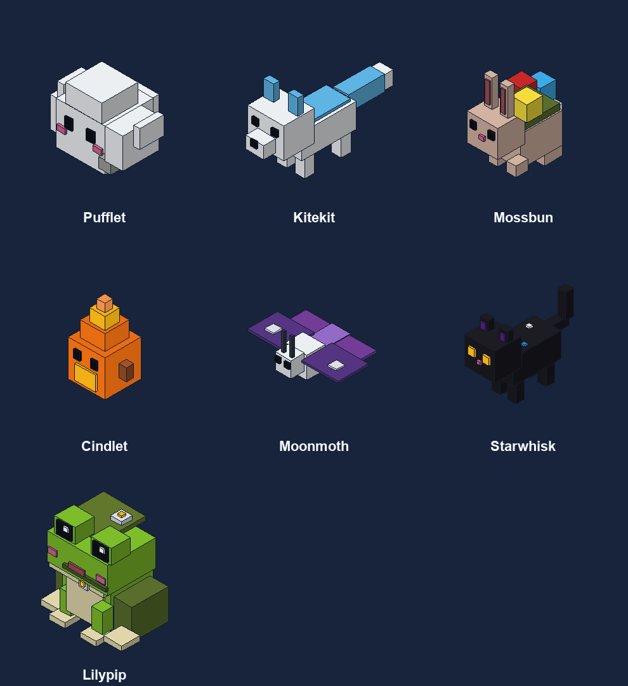

# Cosmetics: companions, trails and supporter ranks

Everything the website store sells is in game, and all of it is visual only: seven companions, eight trails,
three supporter ranks and three bundles. Code lives in `nerdsmp-paper/src/main/java/net/nerdsmp/paper/cosmetic/`.

## For players

| Command | What it does |
|---|---|
| `/cosmetics` (`/wardrobe`) | The wardrobe: summon companions, wear trails, pick a name colour, use presets, claim the keepsake. |
| `/companion [name]` / `/companion dismiss` | Summon a companion you own / send it home. `/companion list` shows them all. |
| `/trail [name]` / `/trail off` | Wear a trail you own / take it off. `/trail list` shows them all. |
| `/emote <name>` | wave, cheer, heart, bow, dance, sparkle. Cloudkeeper and Starweaver only; players within 24 blocks see it, unless they ignore you. |

The chosen companion, trail and name colour are saved per account and come back after logging in.
`/settings` → *Other players' companions and trails* hides everyone else's cosmetics for that player.

## What each purchase gives

| Store item | Product id | In game |
|---|---|---|
| Skyfarer | `cosmetic.rank.skyfarer` | Aqua ✦ badge in chat, the tab list and above your head; 3 name colours |
| Cloudkeeper | `cosmetic.rank.cloudkeeper` | ☁ badge; 5 name colours; emotes |
| Starweaver | `cosmetic.rank.starweaver` | ✧ badge; 7 name colours; emotes; 3 wardrobe presets; Starweaver Lantern keepsake |
| Pufflet … Lilypip companion | `cosmetic.companion.<name>` | That companion (`pufflet`, `kitekit`, `mossbun`, `cindlet`, `moonmoth`, `starwhisk`, `lilypip`) |
| Cloudstep … Stardust Waltz trail | `cosmetic.trail.<name>` | That trail (`petal-skip`, `firefly-drift`, `rune-ripple`, `comet-tail`, `dandelion-drift`, `stardust-waltz`) |
| Cloudberry bundle | `cosmetic.bundle.cloudberry` | Pufflet + Cloudstep + Skyfarer rank |
| Blooming Skies bundle | `cosmetic.bundle.blooming-skies` | Mossbun + Petal Skip + Skyfarer rank |
| Celestial Dreams bundle | `cosmetic.bundle.celestial-dreams` | Starwhisk + Stardust Waltz + Skyfarer rank |

The former two-item default bundle lists in existing `config.yml` files upgrade to include Skyfarer
when loaded. Custom bundle contents remain intact. The bundle entitlement owns its included rank:
revoking it removes that source of Skyfarer without removing separately owned ranks.

Higher ranks include everything below them. The older `supporter_monthly` and `supporter_annual` products
still work and carry every perk, shown with the classic gold ✦.

## Connecting Tebex

For each Tebex package, add a command that runs when the player is online or offline:

```
nerdadmin entitlement grant {username} <product id> {transaction}
```

and a refund/chargeback command:

```
nerdadmin entitlement revoke {transaction} Refunded
```

Grants are idempotent on the transaction id, so Tebex retrying a command never grants twice. Unknown product
ids are refused with a clear message instead of being stored, and `/nerdadmin entitlement products` lists every
valid id. A player who is online when the grant arrives is told straight away; everyone else sees their new
cosmetics the next time they join. Ownership is re-read once a minute, so a refund removes the item within a minute.

Staff can hand out a cosmetic for events or testing the same way, with a made-up transaction id such as
`staff-2026-10-19-ava`.

## How companions work



*Preview in flat colours; in game each block has its normal texture.*

Companions are block sculptures, in the style of the armor-stand pets on Hypixel and Mineplex. Each one is
built from 10 to 28 small blocks: a white wool cloud with stubby feet (Pufflet), a sky-blue fox (Kitekit), a
cream bunny with a moss garden and flowers on its back (Mossbun), a glowing ember with a flickering flame
(Cindlet), an amethyst moth with stained-glass wings (Moonmoth) a black cat with glowing eyes and stardust
(Starwhisk) and a lily frog with a lily-pad hat, clover necklace and water droplet (Lilypip).

Each block is a **block display** entity, the modern version of an armor stand holding a block. Displays
have no hitbox and no AI, never save to the world, cost far less than armor stands, and can be any size.
All of a companion's blocks stand at the same spot and face the same way; each block's transformation
places it within the model.

**Shapes** live in `plugins/NerdSMP/companion-models.yml`, copied out of the jar on first start. Positions
and sizes are in pixels (16 = one block), like a Blockbench model, so staff can reshape a companion or design
a new one without code. If the edited file has a mistake, the server logs which part is wrong and uses the
built-in models. `scale`, `flying`, `particle` and `model` for each companion are in `config.yml`.

**Movement:** every two ticks the sculpture eases toward a spot behind its owner's shoulder. Walking companions
stand on the ground; flying ones hover beside the owner's head with a gentle bob. It turns to face where it's
going and reappears beside its owner after a long teleport. The client glides each block between updates
(teleport and transformation interpolation), so movement looks smooth.

**Animation:** parts are grouped. Legs (`leg_a`, `leg_b`) swing in opposite pairs while walking. Tails wag,
heads nod, ears twitch, wings flap (harder for flyers) and flames flicker taller and shorter. Foxes and cats
trot with a small bob, and Mossbun hops. Glowing parts (embers, the cat's eyes, moth wing spots) are lit at
full brightness, and walking companions cast a soft shadow.

**Rules:** a companion is put away while its owner is dead, a spectator or invisible, and returns afterwards.
Players who hide other players' cosmetics don't see it. Nothing can interact with it.

## Tests

`CosmeticCatalogTest` covers the catalog, product ids, bundles, tiers and older subscriptions.
`CompanionMotionTest` covers following, snapping, facing and trail particle limits. `SculptureTest` checks every
bundled model (real blocks, size, part count) and that legs, wings and flames pivot from the right place. Run them with the
plugin's test suite.
