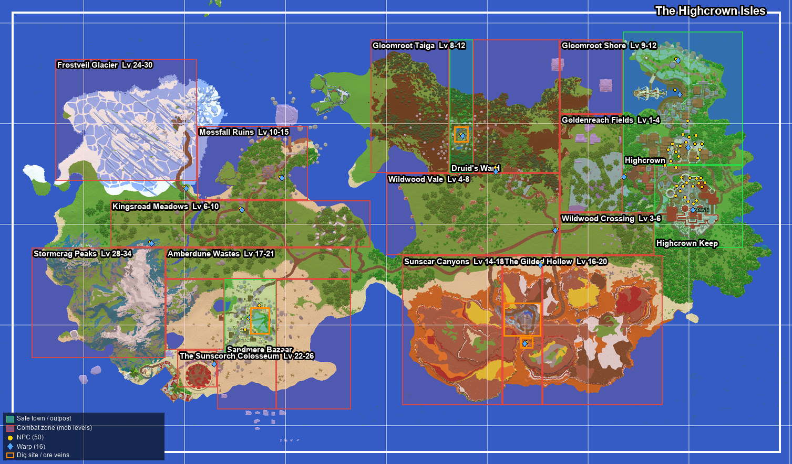

# The Highcrown Isles (spawn map content)

The spawn map from `MMORPG - 1.19.zip` ships with everything it needs to play as a small MMORPG: levelled
mob zones, 50 NPCs, 31 story quests in 12 chains, renewable dig sites and ore veins, and 16 warps. Load the
plugin on a server whose main world is this map and the content appears on its own; no staff setup is needed.

## How it loads

`worldpacks/highcrown.yml` (inside the jar) describes the map. About two seconds after startup the plugin
looks for a loaded overworld with the map's seed (`27594263`) and three landmark blocks (the keep gate, the
keep courtyard and the colosseum floor). Only that world is touched; any other map is left alone.

On the first match the pack:

- creates the zones (towns and outposts are safe zones, the wilds are combat zones with spawn points and rosters);
- registers the dig sites and ore veins inside those zones;
- places every NPC on a verified floor tile (stable anchor ids, so it never duplicates them);
- saves the warps and sets the public spawn to the keep gate (777.5, 101, −35.5);
- raises the world from Peaceful to Normal once, because the map was saved on Peaceful and zone creatures
  cannot spawn there (staff can still choose Peaceful later with `/difficulty`; the pack won't change it again);
- turns off vanilla night monsters in this world. Monsters come only from the zones;
- keeps players on the map (see [Map border](#map-border)).

What it wrote is recorded in `plugins/NerdSMP/world-packs.yml`. Later startups do nothing unless a newer
pack version ships. Then the pack updates only the objects that still match what it last wrote: a zone,
dig site or warp that staff edited is kept, and an NPC that staff removed stays removed.

Staff commands (`nerdsmp.zone.admin`):

| Command | Does |
| --- | --- |
| `/worldpack` | Shows each shipped pack, the matching world and the applied version. |
| `/worldpack apply` | Re-applies packs that have a newer version. |
| `/worldpack apply force` | Re-applies the current version too (staff edits are still kept). |

Turn the whole feature off with `world-packs.enabled: false` in `config.yml`.

## Map border

Beyond the built island the world is raw generated land: a southern continent from about z 600, a few islets
north of z −560 and one far west. Players can't reach it. The playable rectangle is x −950…1000, z −540…580
(`border` in the pack, the white outline on the map above).

- A vanilla world border covers the long axis (x −950…1000, 1951 blocks wide): the usual red wall and a hard
  stop. It is set on every start unless staff have set a border of their own, which is kept.
- Vanilla borders are square, so the plugin holds the north and south edges itself. A curtain of mist shows
  near the edge; anyone who crosses it on foot, swimming, by boat or by elytra is put back where they last
  stood inside (or just inside the nearest edge). Ender pearls and chorus fruit that would land outside are
  cancelled.
- Spectators and players with `nerdsmp.worldpack.bypass` (operators by default) can cross freely. Staff
  `/tp` and plugin teleports are not blocked, but a non-staff player sent outside is returned inside.

## Regions

| Zone | Levels | Creatures | Notes |
| --- | --- | --- | --- |
| Highcrown Keep, Highcrown (town, harbour, gardens) | safe | – | Spawn, services and the market |
| Goldenreach Fields | 1–4 | Field Gnawer, Straw Scarecrow, Bristle Boar | Farms west of town |
| Wildwood Crossing | 3–6 | Kingsroad Brigand, Bristle Boar, spiders | Road from the keep to the vale |
| Wildwood Vale | 4–8 | Brigands and crossbows, spiders, zombies | Central plains and orchards |
| Gloomroot Taiga / Shore | 8–13 | Mire Weaver, Gloomroot Wolfhound, Thorn Sentinel, witches | Dark taiga north of the road |
| Druid's Ward | safe | – | Moss crater in the taiga; peat dig site |
| Kingsroad Meadows | 6–10 | Brigands, zombies, wolfhounds | Western road |
| Mossfall Ruins | 10–15 | Mossfall Revenant, Bog Oracle, skeletons | Overgrown temple isle |
| Sunscar Canyons | 14–19 | Canyon Skulker, Dust Raider, Veil Stalker, husks | Badlands terraces |
| The Gilded Hollow | 16–20 | Tunnel Lurker, Dust Raider, Emberbound, Gilded Overseer (elite) | Open-pit gold mine; ore veins and red-sand dig |
| Amberdune Wastes | 17–24 | Dune Scorpion, Sandwraith, husks | Desert around the bazaar |
| Sandmere Bazaar | safe | – | Desert outpost; oasis dig site; merchants trade here |
| The Sunscorch Colosseum | 22–26 | Pit Gladiator, Net-Caster, Champion of the Sands (elite) | Arena on the southern shore |
| Frostveil Glacier | 24–30 | Frostmarked, Rime Wolf, polar bears, strays | Ice-spike glacier |
| Stormcrag Peaks | 28–34 | Stormcrag Ram, Stormcaller Shade, Frostmarked, strays | Snowy mountains |

Creature levels are the zone's own; they are separate from a player's adventurer level. The new creatures
live in `content/world-mobs.yml` (same format as `content/mobs.yml`; an entry with the same id in
`content/mobs.yml` overrides it). The southern continent (z 600–1000) is raw generated terrain and is left
unzoned for later.

## NPCs

The existing service NPCs fill the keep courtyard (guide, registrar, bank, identifier, forge, enchanter,
mastery, portal master, herald, graves, relics, expeditions, contract clerks) and the market plaza north of
the keep (all shops, wardrobe, jobs, party, duels, claims, surveyor, angler). Nineteen new NPCs
(`content/world-npcs.yml`) give quests across the map:

| Where | NPCs |
| --- | --- |
| Keep | Steward Aldric (main story), Corwin Ashblade (trainer: skills and mastery), Captain Brenna Holt |
| Harbour and gardens | Harbormaster Wynn, Liss Fernwhistle (seed and sapling shop) |
| Field and road | Odo Thatch (Goldenreach), Waywarden Garet (crossroads), Tobin the peddler (western road) |
| Gloomroot | Ilsa Vane (lumber camp), Elder Rowan Moss (Druid's Ward) |
| Mossfall | Imre Valcourt |
| Sunscar | Scout Dren (canyon rim), Magda Hale (mine) |
| Sandmere | Samar al-Rashan, Kasim (desert-goods shop), Nadira (oasis), Tavros (colosseum) |
| North and west | Warden Halvard (glacier road), Orla (Stormcrag foothills) |

A quest giver's greeting has a "What needs doing?"-style reply that opens their **quest board**. Merchants in
an enabled safe zone (Highcrown, Sandmere, the Druid's Ward) can trade even when they are farther than
`skyblock.market.hub-radius` from spawn; set `skyblock.market.safe-zone-outposts: false` to keep trading
at the hub only.

## Quests

`content/world-quests.yml` holds the story quests. Each has a giver, an optional turn-in NPC, prerequisite
quests, a minimum adventurer level, up to six objectives and rewards (Marks, skill XP, faction reputation,
items).

| Objective | Counts when |
| --- | --- |
| `kill` | the player kills the listed creature, optionally inside a zone |
| `harvest` | the player breaks the listed block, e.g. gold ore at the Gilded Hollow veins |
| `dig` | the player digs soil at a dig site, optionally a listed material |
| `visit` | the player enters the zone |
| `talk` | the player talks to the listed NPC |
| `deliver` | the player hands the items over at turn-in (they are taken then) |

Chains: Highcrown welcome → Sword and Shield; Goldenreach harvest (3); Gullwater harbour; Lanternmere
gardens; Kingsroad justice (3); Gloomroot hunt (4); Mossfall echoes (2); Sunscar gold (4); Sandmere bazaar (4);
Sunscorch colosseum (2); Frostveil watch (3); Stormcrag storms (2).

Players use `/journal` (also `/questlog`) to see active quests and `/journal abandon <quest>` to drop one.
Staff with `nerdsmp.quests.admin` can use `/journal admin <player> info|complete <quest>|reset [quest]`
(completing grants no rewards). Progress is saved in `plugins/NerdSMP/quest-progress.yml`. To customise the
quests, copy the file to `plugins/NerdSMP/content/world-quests.yml`; that copy replaces the shipped one.

## Dig sites and ore veins

| Site | Zone | Blocks | Regrowth |
| --- | --- | --- | --- |
| `gilded_veins` | The Gilded Hollow | ~1,070 exposed gold, coal and iron ore | 90 s |
| `canyon_red_sand` | The Gilded Hollow | red sand on the mine's south rim | 30 s |
| `oasis_dig` | Sandmere Bazaar | sand around the oasis | 30 s |
| `druid_peat` | Druid's Ward | coarse dirt, dirt and clay in the crater | 30 s |

Dig sites now also accept ore blocks: a mined vein node gives Mining XP and grows back like a dig node.
Everything else on the map stays protected. `/digsite list` shows the sites with travel links.

## Warps

`/warp highcrown | market | harbour | gardens | goldenreach | crossroads | gloomroot | druids_ward | mossfall |
kingsroad | sunscar | gilded_hollow | sandmere | colosseum | frostveil | stormcrag`.

## Changing the layout

The pack was generated from a scan of the world's region files: every NPC anchor, warp and spawn point was
checked for a solid floor and headroom (1,168 spawn points in all), then tested in game with bots. To change it, edit
`worldpacks/highcrown.yml` and bump `version` so servers that already applied it pick up the change. Tests in
`HighcrownContentTest` check that every zone, creature, NPC, quest objective and node site reference resolves.
